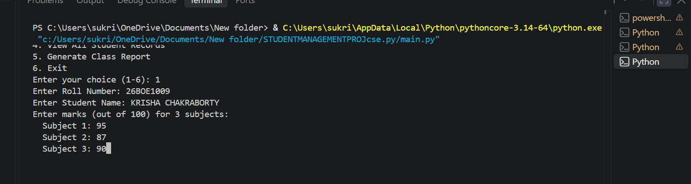
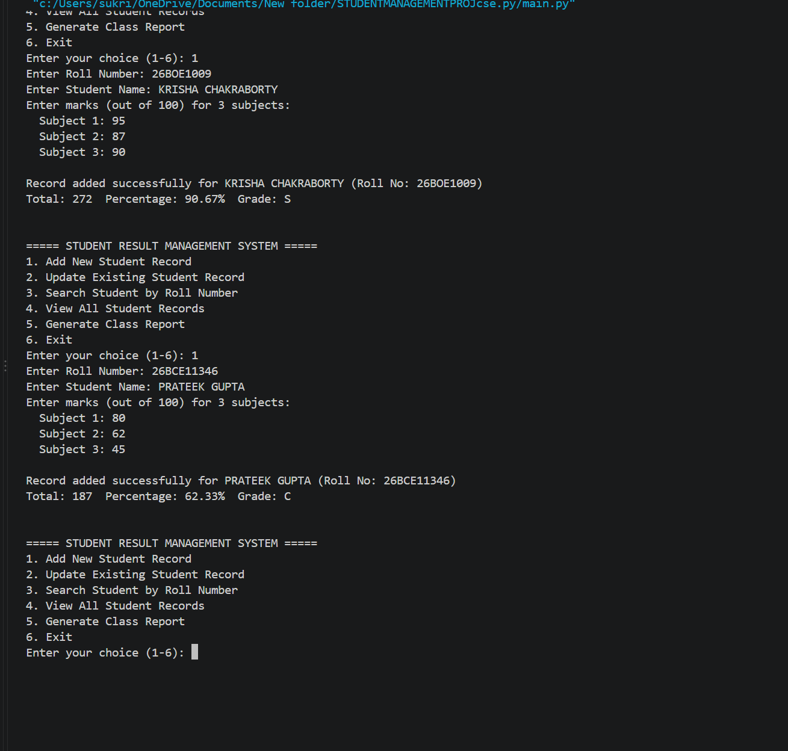
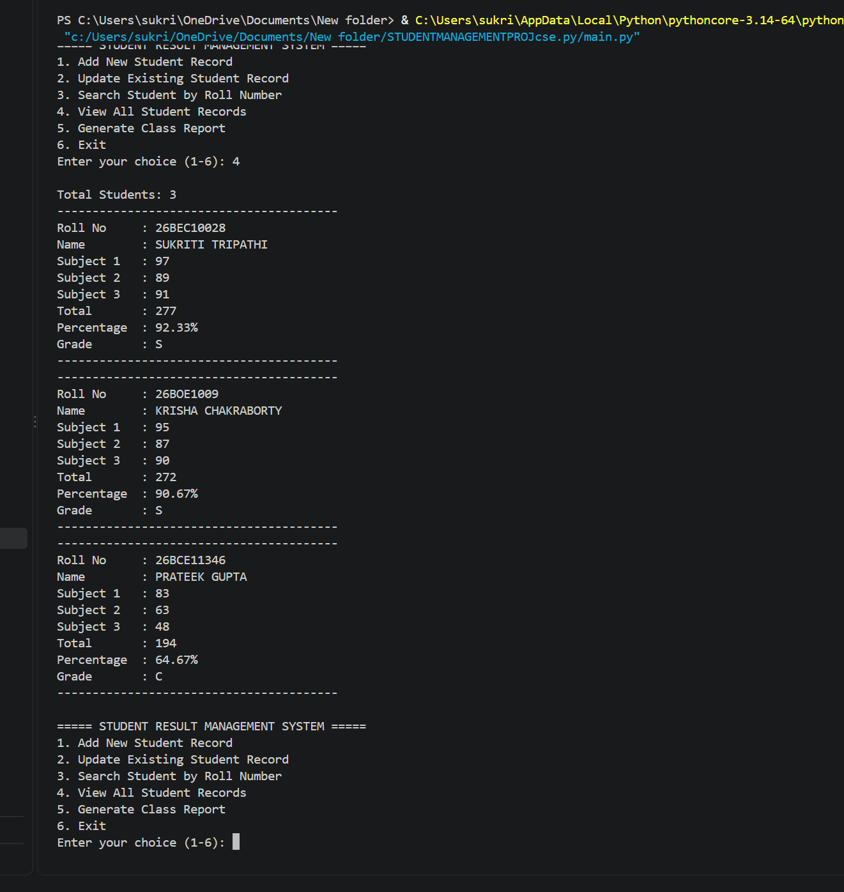
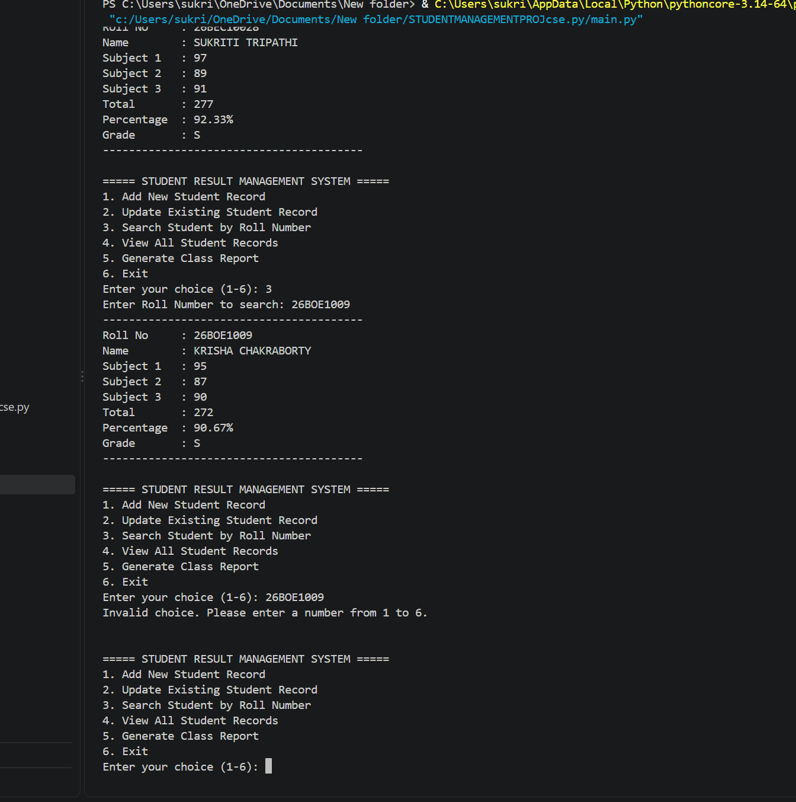
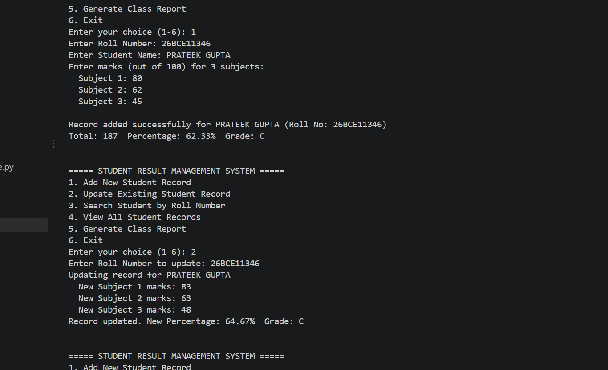
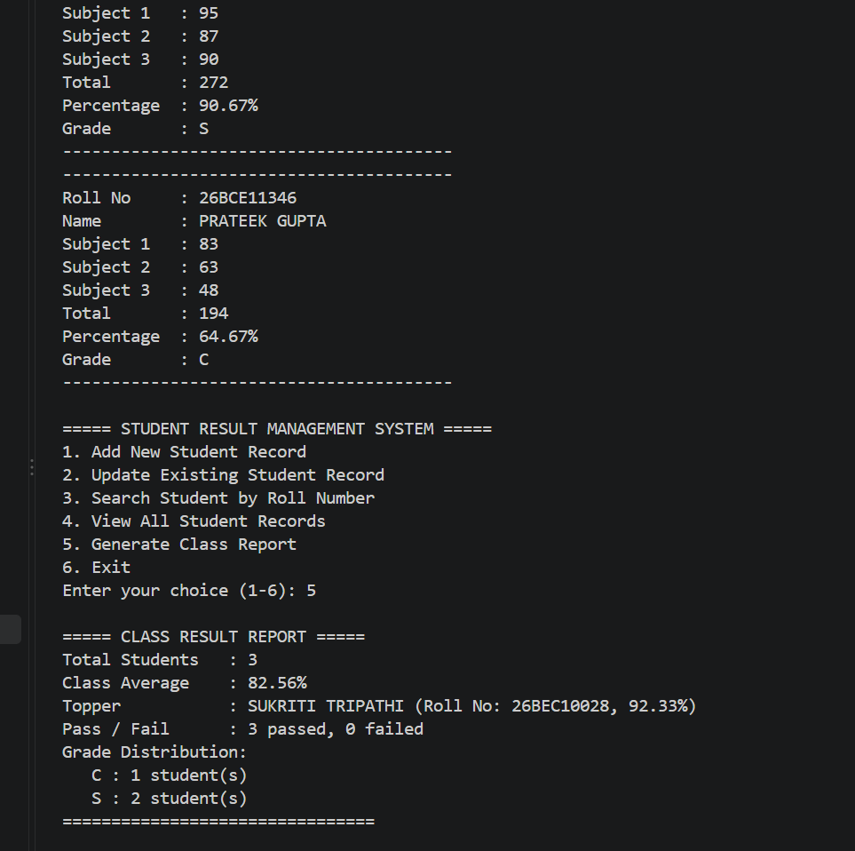
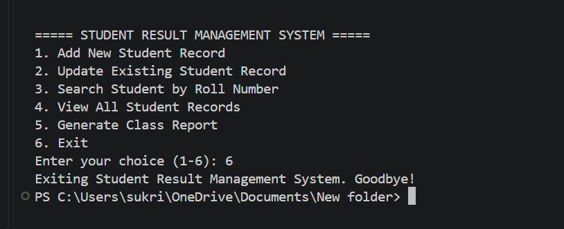

# Student Result Management System

## Overview

I developed a Python program that is console-based in order to manage and analyse student results. The program allows you to enter student marks, search for or view existing records, and produce a report for the entire class. I created this project as part of the VITyarthi "Build Your Project" assignment in CSE1021 - Introduction to Computer Problem Solving.

## Features

- Add a student record with roll number, name, and marks for three subjects
- Automatically calculates total marks, percentage, and grade
- Update an existing student's marks whenever needed
- Search for a student using their roll number
- View all stored student records at once
- Generate a class report with the class average, the topper, pass/fail count, and grade distribution
- The data is stored in a CSV file called `students.csv`, which means the records will remain saved between different runs

## Technologies / Tools Used

- Python 3
- Built-in `csv` module for storing data
- No external libraries needed

## Project Structure

```
STUDENTMANAGEMENTPROJcse/
├── main.py            # Menu-based entry point
├── add_record.py       # Module 1: Add or update student record
├── search_record.py    # Module 2: Search and view student record
├── report_module.py    # Module 3: Report generation and analytics
├── data_handler.py     # Takes care of reading and writing the students.csv file
├── utils.py             # Calculates grades, finds percentages, checks input
├── students.csv         # Auto-created data file (student records)
└── README.md
```

## Steps to Install & Run

1. Ensure that Python 3 has been installed (you can check by running `python3 --version`).
2. Clone this repository.
3. In the project folder, open a terminal.
4. Run:

```
python main.py
```

5. You can add records, search, view records, or generate a report by using the menu (choosing one of options 1 to 6).

## Instructions for Testing

1. Select option 1 and include two or three example students with their marks.
2. To verify that the records have been saved correctly, select option 4.
3. Select option 3 and search for the record using the roll number which you have just entered to make sure that the details agree.
4. To update a student's marks, select option 2 and verify that the grade is calculated correctly.
5. To produce the class report select option 5 and make sure that the average, the topper's score, and the grade distribution agree with the data you entered.
6. Test the program by entering letters rather than numbers or a mark that is out of range, to make sure that it displays an error message instead of crashing.

## Screenshots

Entering a new student's details:



Record added, with total, percentage and grade calculated:



Viewing all student records:



Searching for a student by roll number:



Updating a student's marks:



Class report with average, topper, pass/fail count and grade distribution:



Exiting the program:

